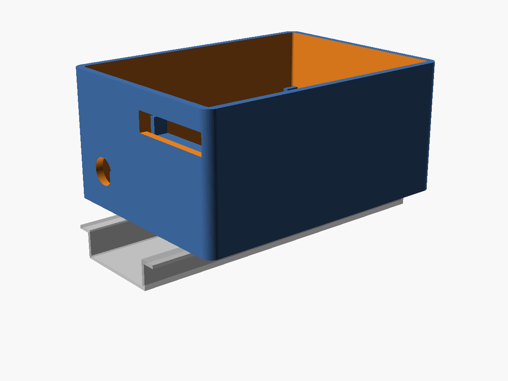
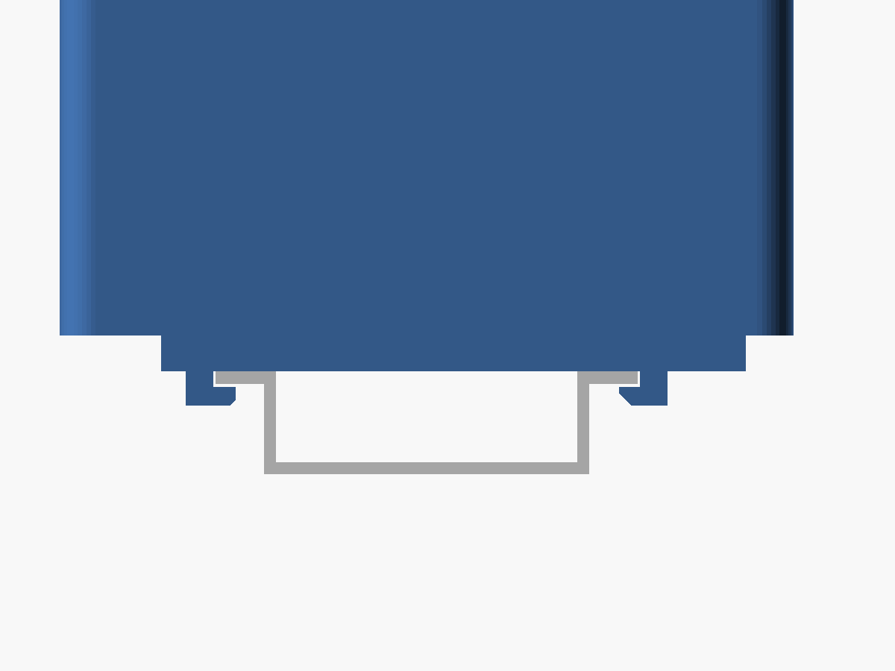
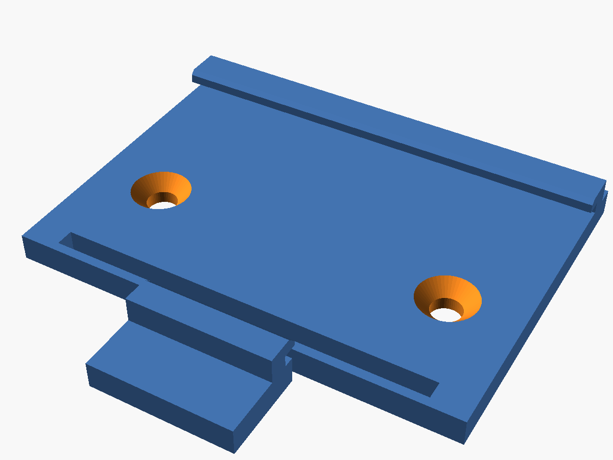

# ESP32-C6 + RS-485 Sniffer Enclosure – DIN Rail Version

This is the same enclosure as the [free-standing version](../freestanding/README.md),
plus a **snap-on clip for a standard 35 mm DIN rail (TS35)**, so it mounts cleanly
next to the circuit breakers in a distribution cabinet.

## What's included

- An enclosure body with two screw bosses in the floor
- A friction-fit lid with vent slots and an engraved label
- A separate DIN rail clip

## DIN clip design

- A fixed hook on one side and a spring latch on the other, so it clicks onto the rail.
- The spring is a flexure beam that bends in the plane of the print layers. It flexes
  reliably and won't split along layer lines.
- To remove it, put a flat screwdriver in the pull tab and lever the latch open.
- The clip prints flat with the hooks facing up, with no supports.
- It attaches with **2× M3×10 countersunk screws**, inserted from the rail side. They
  self-tap into the 2.5 mm holes in the bosses, so no nuts are needed. The screw heads
  sit inside the rail channel.

## Specs

- Depth from the rail: about 43 mm
- Width along the rail: about 82 mm
- The rail runs along the long side of the enclosure. USB-C and the bus cable both exit
  at the same end, so leave about 35 mm free on that side for the USB plug.

## Print settings

- The same as the free-standing version: PETG, 0.2 mm layers, 3 perimeters, no supports.
- Tip: print the clip alone first and test-fit it on your rail. It only takes a few
  minutes.

## Hardware

- 2× M3×10 countersunk screws (DIN 7991 / ISO 10642)

## Files

| File | Content |
|---|---|
| `esp32c6_rs485_case_din.stl` | body with bosses + lid + clip, ready to slice |
| `preview_din_assembly.png`, `preview_din_clip_side.png`, `preview_din_clip.png` | renders |
| [`../source/esp32c6_rs485_case.scad`](../source/esp32c6_rs485_case.scad) | parametric OpenSCAD source (`part="all_din"`, `"clip"`, `"din_assembly"`) |
| [`../source/build.sh`](../source/build.sh) | regenerates all STL files and previews |

