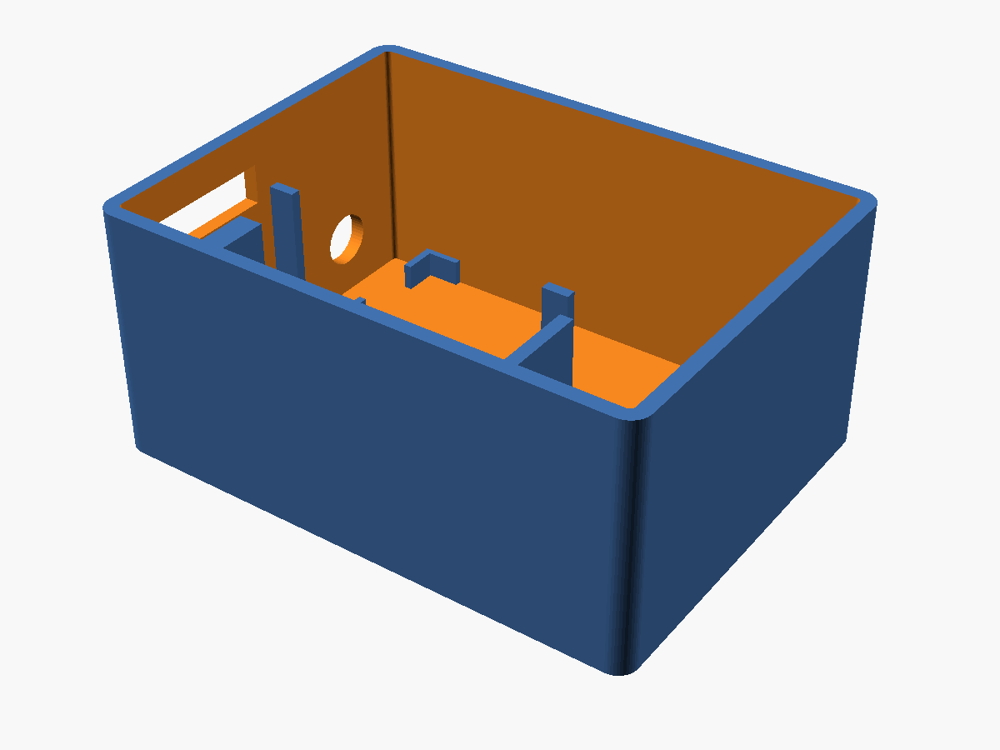
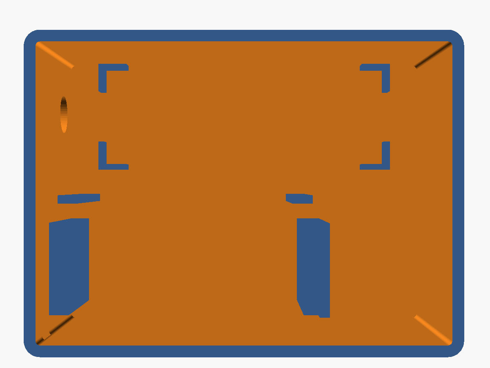
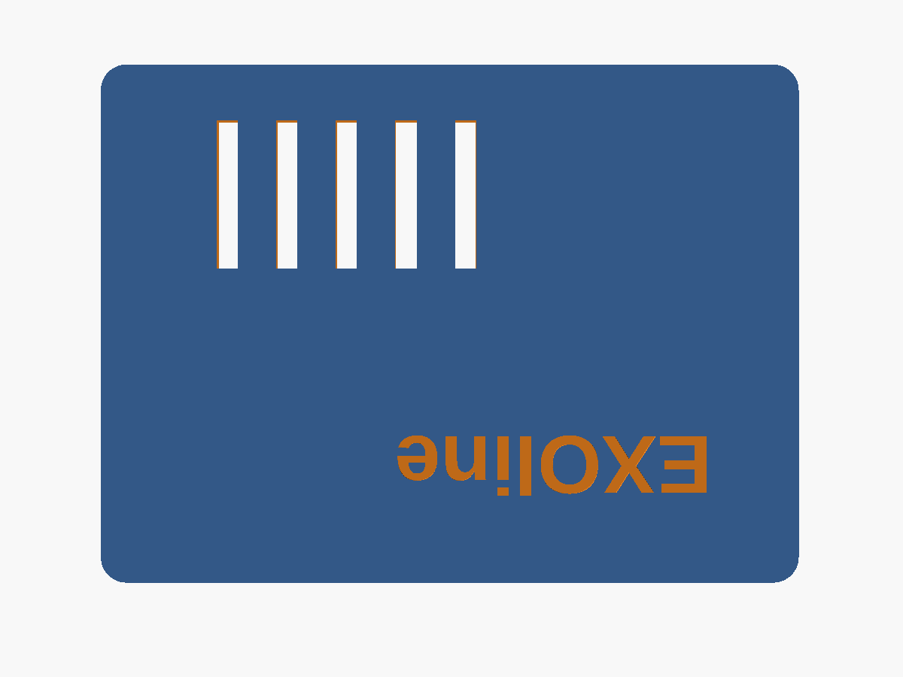

# ESP32-C6 + RS-485 Sniffer Enclosure (free-standing)

A compact enclosure for an **ESP32-C6-DevKitC-1** and a **KAMAMI KAmodRS485-3V3**
(UART ↔ RS-485) module. I designed it for a passive bus sniffer that reads a Regin
EXOcompact heating controller (EXOline protocol) and sends the data to Home Assistant
through ESPHome. It works for any project that combines these two boards.

## Features

- The ESP32 sits on raised supports, 24 mm above the floor. That leaves room for
  Dupont jumpers on the downward-facing header pins.
- A 26 × 6 mm cutout in the front wall gives access to both USB-C ports, for power and
  flashing.
- The RS-485 module lies on the floor, held by corner stops, with about 6.5 mm of free
  space at each end. Place it with its screw terminals facing the front wall.
- An 8 mm hole in the same front wall, next to the USB cutout, takes the bus cable
  (A, B, GND). All cables leave on one side.
- The lid is a friction fit, with vent slots above the ESP32 and an engraved
  "EXOline" label.
- Fully parametric OpenSCAD source: board sizes, clearances, wall thickness and lid
  tolerance are all at the top of the file.

## Specs

- Outer size: about 82 × 61 × 40 mm, including the lid
- Wall thickness: 2.2 mm

## Print settings

- Material: PETG recommended, since it copes with the heat inside an electrical
  cabinet better than PLA
- Layer height: 0.2 mm
- Walls: 3 perimeters
- Infill: 15–20 %
- **No supports needed.** The body prints upright and the lid prints top face down.

## Tips

- If the lid is too tight or too loose, adjust `lip_clr` (default 0.25 mm).
- If your Dupont wires need more room under the ESP32, increase `esp_z`.
- `usb_overhang` sets how far the USB-C connectors stick out past the PCB edge
  (default 1 mm).
- `kam_shift` moves the RS-485 module away from the front wall if you need more room
  for the bus cable.

## Files

| File | Content |
|---|---|
| `esp32c6_rs485_case.stl` | body + lid side by side, ready to slice |
| `preview_body.png`, `preview_top.png`, `preview_lid.png` | renders |
| [`../source/esp32c6_rs485_case.scad`](../source/esp32c6_rs485_case.scad) | parametric OpenSCAD source (shared with the DIN rail version) |
| [`../source/build.sh`](../source/build.sh) | regenerates all STL files and previews |

